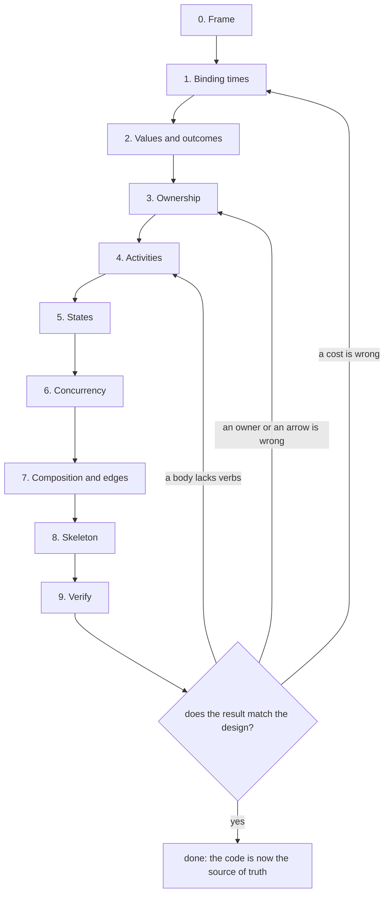
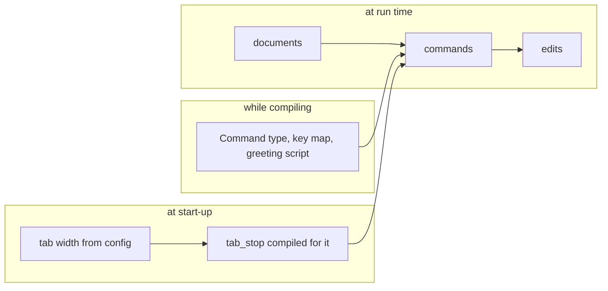
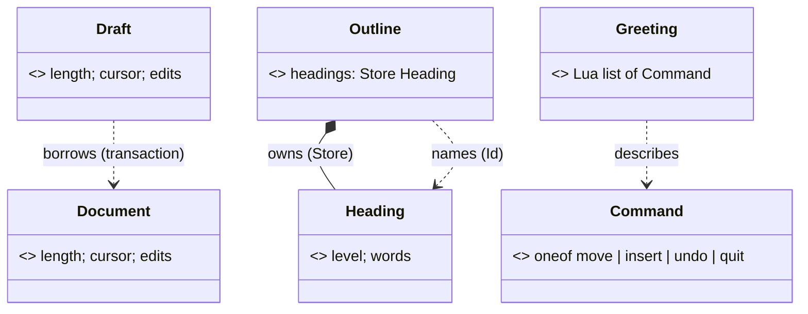
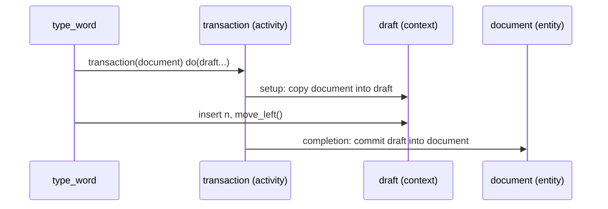
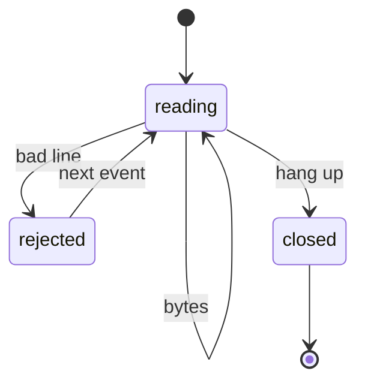
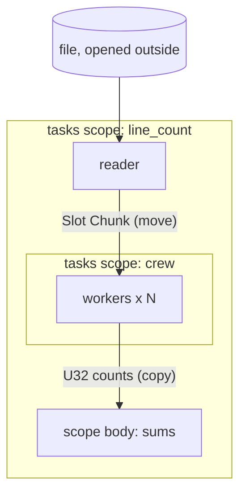
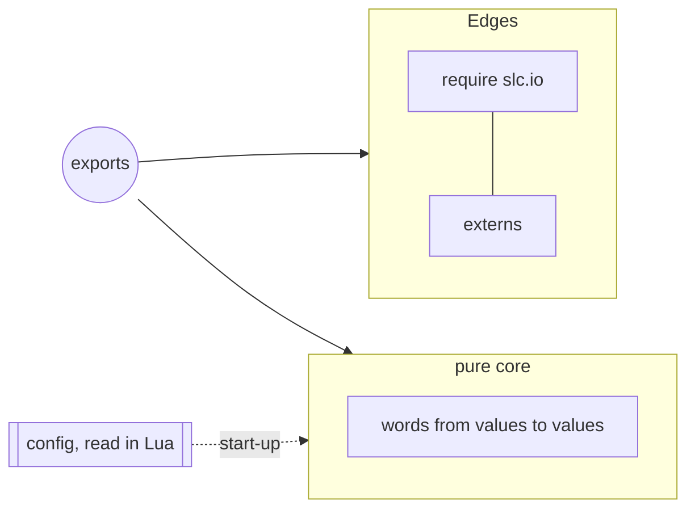

# Designing and writing slc

**Status: a guide to designing and writing programs in slc, beside [the language](syntax.md) and [the compiler](architecture.md), which own the rules.** It follows Let's guide, *Designing and writing Let*, and keeps what transfers. Where slc differs, it says how and why.

* **Part I** is a design process: ten steps, each with the question it answers, the diagram it produces and the condition for moving on.
* **Part II** is about writing words.
* **Part III** is house style.

Every `lua` block below is an excerpt of [`examples/guide.slc`](../examples/guide.slc), which the test suite compiles to strict C and runs; every `c` block is that compilation's actual output. `tests/guide.lua` checks both, so this guide cannot drift from the language. The blocks are `slc fmt`'s default style, which is also the house style (§21). Diagrams are Mermaid, and their notation is explained where it is first used.

## 0. Forms this guide relies on

| Form | Used for |
|---|---|
| `local f = do(x: T): R ... end`, `do(x: T): R = e` | typed words: compiled to native code |
| `function T:m(...): R ... end` | methods: the receiver is `self`, a reference |
| `struct { ... }`, `oneof { ... }` | records and sums |
| `s { name = do(p) ... end, name(p) = e }` | matching a sum: one handler per alternative |
| untyped parameters, `f known` | compile-time parameters, partial application |
| `f "lit"`, `f 1 2`, `f x do ... end` | literal application and saturating chains |
| `do(ctx...)`, `local ctx... = e` | opening a record or a vocabulary |
| `endall` | closing a spine of trailing blocks |
| `s[id]`, `g[i]`, `pool[slot]`, `a[i]` | checked places |
| `tasks do(scope...)`, `spawn do`, `first_of` | concurrency |
| `require "slc.io"` | libraries, including I/O by completion |
| `native word`, `slc run` | compile now, into this process, and call from Lua |
| `call f(x)` | one site as a shared C function, for code size (§11.2) |
| `T.__index`, `T.__add`, `T.__cast`, … | type hooks: what `x[k]`, an operator or a conversion means on a type |

---

# Part I — Designing

## 1. The stance

slc puts **binding time** at the center. A program is Lua that runs while compiling. Typed words are evaluated in place with whatever is known, and only the work that depends on run time remains, as C. Let's question, "what is known, and when?", has an exact answer for every value in an slc program:

* **A Lua value** (a table, a string, a closure, a number in host code) exists only while compiling.
* **A known native value** (`U32 4`, a constant field, a sum with a known tag) is computed while compiling. It shapes the C, and may vanish from it.
* **A runtime value** (a parameter of an export, a read from a file) is in the C.

Three commitments follow from Let and sharpen in slc:

1. **Say it as you think it.** A program is words for its domain, spoken in the contexts where they make sense. The surface is Lua's, extended; it reads as a script and compiles as C.
2. **Never hide what matters.** Ownership, lifetime, failure and cost are visible in the contracts, and in the C: every check, every wait, every allocation is a line you can read.
3. **Grow the vocabulary in Lua, not the language.** Configuration, dialects, generators and tests are Lua running at compile time. A new macro is a last resort.

## 2. The process

Design is ten steps. Each answers one question and produces one thing, usually a diagram. A step is done when its exit condition holds, and some later findings send you back to an earlier step.



| Step | Question | Produces | Done when |
|---|---|---|---|
| 0. Frame | What is the job? | one paragraph: inputs, outputs, scale, what must be fast | every later decision can point back to it |
| 1. Binding times | What is known when? | a diagram in four lanes | everything known before steady state is marked to be a description |
| 2. Values and outcomes | What does the program talk about? | records and sums | every outcome a caller acts on is a sum |
| 3. Ownership | Who owns what, and what is each relationship? | a class diagram with roles and labelled arrows | every mutable thing has one owner; no reference outlives an activity |
| 4. Activities | What bounded work happens? | a sequence diagram per use case | every activity's completion, and its abort, has an owner |
| 5. States | What has a lifecycle? | state diagrams, then sums and transition words | every state is a variant; every match is complete |
| 6. Concurrency | What runs at the same time? | a dataflow of tasks, channels and scopes | one owner task per entity; every channel has a closer, every scope an end |
| 7. Composition and edges | Who connects the parts, where does the world come in? | a component diagram | the core is pure and depends on no edge |
| 8. Skeleton | Does it hold together? | code that compiles, top-down | each diagram element has its code, and the compile-time asserts pass |
| 9. Verify | Does it cost what we said? | the C read, tests, the fuzzer, numbers | step 0's requirements are met, or a step to go back to is chosen |

**Going back.** Each symptom points to one step:

* **A hot path still loops or switches over configuration:** step 1. Something placed at run time is known earlier.
* **Two places want to change the same thing, or a reference must be kept:** step 3. An owner or an arrow is wrong; it should be an `Id` or a message.
* **A body reaches around its context** for things the context does not offer: step 4. The activity lacks verbs, or two activities are mixed.
* **A match grows a "cannot happen" arm:** step 5. A state is missing.
* **Tasks need a lock, or a channel cannot be closed cleanly:** step 6. An entity's owner task or the scope structure is wrong.

**Three habits throughout:**

* **Answer one question per step.** Do not decide ownership while naming values, or concurrency while designing activities.
* **Keep each diagram to a screen.** A diagram that does not fit covers two concerns.
* **Hand over to the code.** Once the skeleton compiles, the code is the source of truth. Diagrams should then come from it (slc's types and words are Lua values, so they can be walked and printed), not be maintained beside it.

**Draft top-down.** Write the word you wish you had, then the words it needs. slc compiles only what exports reach, so a draft costs nothing until something uses it.

## 3. Step 1: binding times

Place every piece of information the program uses in one of four lanes:

| Lane | Examples | Becomes |
|---|---|---|
| **source** (while compiling) | record types, a key map, a protocol, limits | Lua values and descriptions |
| **start-up** | a config file, command-line flags, a schema, a file's header | descriptions too, specialized on with `native` |
| **steady state** | documents, connections, user data | runtime values |
| **per event** | a keystroke, a request, a line | runtime values, the hot path |

Anything in the first two lanes should reach the code as a description: a Lua table, a known value, or an untyped parameter. The engine is then specialized on it, not left to interpret it at run time.



*Lanes are binding times; an arrow from left to right is a value that is known before the code that uses it runs, so that code can be specialized on it.*

**Start-up is a binding time.** `native word` compiles a word into this process and returns it as a Lua function, so a value read at start-up can be specialized on like a table written in the source: `native(tab_stop { tab_width = width })`. Keep the reading in Lua and the work in words; the same words compile ahead of time.

**Where specializing pays, as measured.** Not every known value is worth a specialization:

| What became known | Speedup measured |
|---|---|
| a scalar the code merely uses (a field's position, a count of decimals, a constant key) | 1.06–1.11× |
| a dominant sum tag, guarded per element | 1.06–1.08× |
| **a program interpreted per input (a 33-instruction bytecode)** | **16×** |

Binding time matters most for **data that drives control flow**: programs, grammars, schemas, protocols, key maps, state machines. Making a constant known removes a load; making a description known removes the interpreter. Compiling with `native` costs about 20 ms for the smallest unit and 30–70 ms for a realistic one, so choose start-up specialization where it repays that many times over.

## 4. Step 2: values and outcomes

### 4.1 Values first

Model records and sums before behavior. Anything that is stored, replayed, logged, undone or tested should be data:

```lua
local Direction = oneof { left: Unit, right: Unit }
local Command = oneof { move: Direction, insert: U32, undo: Unit, quit: Unit }
```

Commands as data give undo, replay and tests one foundation, and (§17) they give specialization something to work with.

### 4.2 Outcomes and failures

An outcome a caller can act on is a sum, matched exhaustively. Do not encode absence as a magic value:

```lua
local Found = oneof { found: U32, missing: Unit }
```

```lua
local find_nonzero = do(xs: Slice U32): Found
    local i: U32 = 0
    while i < xs.length do
        if xs[i] ~= 0 then
            return Found.found i
        end
        i = i + 1
    end
    return Found.missing()
end
```

The libraries follow the same rule: a receive is `oneof { value: T, closed: Unit }`, and an I/O result is `oneof { done: U32, failed: I32 }`.

**Which kind of failure is which:**

| Situation | Expressed as | Example |
|---|---|---|
| a caller can act on it | a sum | `missing`, `closed`, `failed(errno)` |
| an invariant is broken | a trap, at run time | an index out of range, a stale `Id`, a send on a closed channel |
| it is wrong while still known | a compile-time error | `index-range` on a known index, `signed overflow in +` |
| the world refused | an I/O outcome sum | `failed(e)`, `timed_out` |

A compile-time error is reported even in an arm that dynamic control may never reach. Guard such arms with a condition the compiler can see, or keep the value unknown there.

## 5. Step 3: ownership

### 5.1 Roles and relationships

**Every type plays one role:**

| Role | What it is | slc forms |
|---|---|---|
| **value** | copied freely; owned by whoever holds it | `struct`, `oneof`, `Array`, `Chars n` |
| **entity** | has identity and persists; lives in a store, named by an `Id` | a struct in a `Store T` |
| **owned** | resizable storage, created in place, moved only by `Ref` | `Store`, `Grow`, `Text`, `Map`; a struct holding one (a ring buffer) |
| **view** | a window on someone else's storage, bounded by an activity | `Slice`, `Str` |
| **handle** | a small name for something the runtime owns; crosses tasks | `Chan`, `Pool`, `Slot` |
| **description** | known while compiling; shapes the code | a Lua table, a known value |

**Every relationship is one of four kinds:**

| Arrow | Meaning | slc form |
|---|---|---|
| **field** | owns | a struct field (trees are fields) |
| **name** | identifies without owning | an `Id T` (graphs are stores) |
| **borrow** | uses for a while | a `Ref T` parameter, or an activity's context; ends with the activity |
| **message** | crosses a task boundary | a channel (copies) or a pool slot (moves) |

There is no fifth arrow. UML's inheritance becomes a `oneof` for variants, or a shared vocabulary for shared behavior. A reference that must outlive an activity is a design error: it is a `name` or a `message`.



*Stereotypes are roles; arrow labels are relationship kinds.*

### 5.2 The rules

* **Give mutable state one owner.** A scope owns its locals; a struct owns its fields; a store owns its slots. Other code receives access explicitly, as a `Ref`.
* **Trees are fields; graphs are stores.** A `Store T` holds objects with stable identity, and an `Id T` names one without owning it:

```lua
local Heading = struct { level: U32, words: U32 }
local Outline = struct { headings: Store Heading }

local add_words = do(outline: Ref Outline, id: Id Heading, n: U32): U32
    outline.headings[id].words = outline.headings[id].words + n
    return outline.headings[id].words
end
```

  `outline.headings[id]` is a place, checked at every use. Nothing holds its address past the stretch it was found in, so the store may grow between two uses.
* **Copying a handle copies the handle.** A `Ref` writes through to its place, an `Id` identifies a slot, and a `Slot` moves between tasks. Copying any of them copies the name, not the thing.
* **Aggregates hold no references.** A struct cannot contain a `Ref`, a `Slice` or a `Str`; long-lived relationships are `Id`s.
* **Lua tables are for compile time.** Open, dynamic data is a Lua table while compiling. At run time, data has a shape.

## 6. Step 4: activities

> **Entities own what persists. Activities own or borrow what is needed for a purpose. Words express what happens inside.**

An activity is a design role made of ordinary parts: a word that sets up a context, runs a body that opens it, and owns completion. In slc it costs nothing extra: the body is a callback evaluated in place, and a private context is an ordinary local that folds away.

### 6.1 Finding activities

**Each use case is an activity.** For each, answer four questions:

1. **What is the entity?** The thing that persists: a `Document`, an `Outline`.
2. **What context does the work need?** A working copy, a borrowed place, a resource, an accumulator.
3. **Who sets it up?** The activity word, before `body(...)`.
4. **Who completes it?** The activity word, after `body(...)`: commit, roll back, give back, report.

**Verbs go on the context; invariants stay on the entity.** The body speaks the context's methods (`Draft:insert`), not the entity's. The entity keeps only what must always hold of it. A free activity word such as `transaction(document: Ref Document, body)` lives beside `Document` without growing it.



*A sequence diagram per use case: the activity word is its own participant, setup and completion are its messages, and the body's verbs go to the context.*

### 6.2 Kinds of activity

| Kind | Setup | Completion | Example |
|---|---|---|---|
| working copy | copy the entity into a context | commit, or discard | `transaction` |
| in place | open a place | nothing; writes went through | `local node... = g.nodes[id]` |
| scoped resource | acquire | release | `with_file` |
| accumulator | create the state | return a result from it | `counting` |
| policy | nothing, or a measurement | record, check, clamp, retry | `counted`, `clamped` |

### 6.3 Enter an activity and speak its verbs

```lua
local Draft = struct { length: U32, cursor: U32, edits: U32 }

function Draft:insert(n: U32): Unit
    self.length = self.length + n
    self.cursor = self.cursor + n
    self.edits = self.edits + 1
end
```

```lua
local type_word = do(document: Ref Document, n: U32): U32
    local moved: U32 = 0
    transaction document do(draft...)
        insert n
        local before = cursor
        move_left()
        moved = before - cursor
    end
    return moved
end
```

`do(draft...)` opens the context. Bare calls use its methods (`insert n`, `move_left()`), and its fields are live places (`cursor`).

### 6.4 Open to work; bind to remember

An opened field name is the field's place: reading it reads the current value. A binding takes the value at that point: `local before = cursor` keeps the cursor from before `move_left()`. Opening a place keeps it a place: `local node... = g.nodes[id]` works on the store's slot itself.

### 6.5 The activity owns completion

```lua
local transaction = do(document: Ref Document, body): Unit
    local draft = Draft { ...document }
    body(Ref draft)
    document = Document { ...draft }
end
```

This one commits a working copy at the end. Its contract is its own: write through, commit, roll back, retry. Three boundaries hold:

* the body's `return` leaves the body, not the activity;
* cleanup and commit are the activity's code, not a side effect of opening;
* a borrow cannot outlive its activity, but an owned result may leave it.

The working copy costs nothing. The whole activity becomes field copies:

```c
uint32_t type_word(Document *document, uint32_t n) {
    Draft draft;
    draft.length = document->length;
    draft.cursor = document->cursor;
    draft.edits = document->edits;
    draft.length = draft.length + n;
    draft.cursor = draft.cursor + n;
    draft.edits = draft.edits + 1u;
    uint32_t before = draft.cursor;
    if (draft.cursor > 0u) {
        draft.cursor = draft.cursor - 1u;
    }
    uint32_t moved = before - draft.cursor;
    document->length = draft.length;
    document->cursor = draft.cursor;
    document->edits = draft.edits;
    return moved;
}
```

### 6.6 The body decides; the activity completes

A body cannot leave its activity, so it cannot abort by jumping out. **It returns an outcome, and the activity matches on it to choose its completion:**

```lua
local Outcome = oneof { commit: Unit, abort: U32 }

local attempt = do(document: Ref Document, body): Bool
    local draft = Draft { ...document }
    local committed: Bool = body(Ref draft) {
        commit() = true,
        abort(reason) = false,
    }
    if committed then
        document = Document { ...draft }
    end
    return committed
end
```

```lua
local type_capped = do(document: Ref Document, n: U32, cap: U32): Bool
    return attempt document do(draft...)
        insert n
        if length > cap then
            return Outcome.abort length
        end
        return Outcome.commit()
    end
end
```

```c
bool type_capped(Document *document, uint32_t n, uint32_t cap) {
    Draft draft;
    Outcome r;
    bool r2;
    draft.length = document->length;
    draft.cursor = document->cursor;
    draft.edits = document->edits;
    draft.length = draft.length + n;
    draft.cursor = draft.cursor + n;
    draft.edits = draft.edits + 1u;
    if (draft.length > cap) {
        r = (Outcome){ .tag = Outcome_abort, .as.abort = draft.length };
        goto L1;
    }
    r = (Outcome){ .tag = Outcome_commit };
L1:;
    if (r.tag == Outcome_abort) {
        r2 = false;
    } else {
        r2 = true;
    }
    if (r2) {
        document->length = draft.length;
        document->cursor = draft.cursor;
        document->edits = draft.edits;
    }
    return r2;
}
```

The rule "the activity owns completion" holds when things go wrong too: the body says what happened, and the activity decides what that means for the entity. The outcome type is part of the activity's contract, so give it outcome names (`commit`, `abort`, `retry`), not flags.

### 6.7 Stack activities instead of adding options

Each policy is its own activity, and the order of the spine is the order of completion:

```lua
-- a policy that completes after the work inside it
local clamped = do(document: Ref Document, max: U32, body): Unit
    body()
    if document.length > max then
        document.length = max
        document.cursor = max
    end
end

local import_capped = do(document: Ref Document, stats: Ref Stats, n: U32): Unit
    counted stats do
    clamped(document, 100) do
    transaction document do(draft...)
        insert n
    endall
end
```

The transaction commits first, then the clamp applies, then the count is recorded, exactly as the spine reads from the inside out. `endall` closes the spine; it adds no semantics.

### 6.8 Dialects

A dialect is a vocabulary plus an engine. In slc the engine often runs while compiling: a description built from Lua tables and words is consumed by Lua code that emits only the work that remains (§17). Keep descriptions pure and effects in engines (§9.3).

## 7. Step 5: states

Anything with a lifecycle is a state diagram first:



In slc a state diagram is a `oneof` of states and one word from state to state. Each transition is a value-to-value word, so it can be checked while compiling:

```lua
-- a lifecycle as a sum, and one word per transition
local Conn = oneof { reading: U32, rejected: U32, closed: Unit }
local Event = oneof { bytes: U32, bad_line: Unit, hang_up: Unit }

local step = do(c: Conn, e: Event): Conn = c {
    reading(n) = e {
        bytes(k) = Conn.reading(n + k),
        bad_line() = Conn.rejected n,
        hang_up() = Conn.closed(),
    },
    rejected(n) = Conn.reading 0,
    closed() = Conn.closed(),
}
```

```lua
assert(host(buffered_after(U32 4)) == 7)
```

* **Every state is a variant, and every match handles every variant.** A "cannot happen" arm means a state is missing from the diagram.
* **A known event sequence dissolves the machine.** `buffered_after` starts from a known state and a known event kind, and compiles to `return 3u + k;`. Over runtime events the same `step` is a `switch`: one engine either way (§17).

## 8. Step 6: concurrency

Go's model, fitted to a language without a garbage collector: **tasks share no memory, and every lifetime is a scope.** Draw it as a dataflow: boxes are tasks, arrows are channels labelled copy or move, and frames are scopes.



### 8.1 Share nothing

A spawned block sees the outside through copies taken when it is spawned. Assigning one is rejected, and a `Ref`, `Ptr`, `Slice` or `CString` cannot be copied in at all: each points into memory someone else owns. When the compiler says `a task shares no memory`, the design is asking for a message or a move.

### 8.2 One owner task per entity

An entity that several tasks need belongs to one task; the others send it requests and receive replies on channels they pass along. There is no shared state to draw, so the dataflow never needs a lock.

### 8.3 Scopes own lifetimes

A `tasks` scope ends when its body and all its tasks have, and its channels and pools retire with it. To wait for a group of workers and then act (Go's WaitGroup), give the group a scope of its own, and act when it ends. Every channel in the diagram has a closer, and every scope an end.

### 8.4 Messages are copied; buffers move

Use channels for messages. Use a pool for buffers: take a slot, fill it in place, send the slot. Ownership moves with it, and the receiver uses it in place. `pool[slot]` checks ownership at every use, so a slot used after it was sent traps.

### 8.5 Putting it together

This word counts the lines of a file. The scope body opens the file (a path is a `CString`, which no task may hold) and hands the `File` to a reader task. Workers run in a scope of their own, so `counts` closes exactly when the last worker finishes:

```lua
local line_count = do(workers, path: CString): U32
    local total: U32 = 0
    io.open(path, io.READ) {
        done = do(file)
            tasks do(scope...)
                local chunks = pool(Chunk, 8)
                local filled = channel(Slot Chunk, 8)
                local counts = channel(U32, 8)
                spawn do
                    local more: Bool = true
                    while more do
                        local slot = chunks:take()
                        io.read(file, chunks[slot].bytes) {
                            done = do(n) chunks[slot].n = n end,
                            failed = do(e) chunks[slot].n = 0 end,
                        }
                        if chunks[slot].n == 0 then
                            chunks:release slot
                            more = false
                        else
                            filled:send slot
                        end
                    end
                    filled:close()
                end
                -- the workers run in a scope of their own: when it ends, counts can close
                spawn do
                    tasks do(crew)
                        for _ = 1, workers do
                            crew.spawn do
                                filled:each do(slot)
                                    counts:send(count_lines chunks[slot])
                                    chunks:release slot
                                end
                            end
                        end
                    end
                    counts:close()
                end
                counts:each do(lines)
                    total = total + lines
                end
            end
            io.close(file) { done = do() end, failed = do(e) end }
        end,
        failed = do(e) end,
    }
    return total
end
```

Count what chunking cannot split: a word can straddle two chunks, a newline cannot. The reads go straight into pool slots, and the slots move to the workers, so no byte is copied between tasks.

### 8.6 Choose, time out, block

`first_of` takes whichever operation completes first. It admits operations the runtime can take back: receives, sends, takes and timers:

```lua
        first_of {
            recv replies do(v) answer = v end,
            after(seconds 1) do answer = 0 end,
            closed = do end,
        }
```

I/O is never a case, because the kernel's work cannot be taken back. Give an I/O operation a deadline, or spawn a task for it. A call into C that may block goes in `blocking do ... end`, so it never holds a worker.

### 8.7 When it goes wrong

* **Deadlock is reported, not hung.** The runtime names each wait with its source line.
* **Misuse traps**: a send on a closed channel, a stale handle, a slot used by a task that does not own it.
* **Cancellation is closing a channel.** There is no other mechanism, so no operation grows a third outcome.

## 9. Step 7: composition and edges



### 9.1 Roots, edges, core

* **Exports are the composition roots.** C calls them, and they wire the parts together. Only what they reach is compiled.
* **Effects enter at the edges.** Externs, `require "slc.io"` and the POSIX library are opened at the outside and passed in. The word that opens a file is not the word that parses it.
* **The pure core decides.** Words from values to values are testable while compiling. Applied to known values, a typed word computes in the compiler, and Lua asserts the answer:

```lua
assert(host(tab_stop({ tab_width = 8 }, U32 3)) == 8)
```

### 9.2 What is Lua, and what is a word

The line between host Lua and typed words is the main structural decision of an slc program:

| In host Lua | In typed words |
|---|---|
| reading configuration, flags and schemas | everything that runs |
| building descriptions: types, tables, scripts | engines that consume descriptions |
| generating types and vocabularies | the domain's verbs |
| choosing what to compile (`export`, `native`) | |
| compile-time tests (`assert(host(...))`) | |

Modules are ordinary Lua values returned through `require` (see [module loading](architecture.md#13-modules-and-the-compilation-scope)). A library module exports types and words; a program module exports its edges.

### 9.3 Discipline for compile-time Lua

Lua at compile time can do anything, and a convention is not a sandbox. Keep generators and description builders:

* **deterministic:** no clock, no unseeded randomness, no I/O except declared start-up input;
* **pure:** functions of their inputs, because specialization keys and caching assume that equal inputs give equal code.

## 10. Step 8: the skeleton

Write code top-down, in this order:

1. **Types** from steps 2, 3 and 5: values, entities, owned storage, sums.
2. **The composition root,** with the words you wish you had.
3. **The pure core,** with compile-time asserts as you go.
4. **Activities and their contexts** from step 4.
5. **Tasks and channels** from step 6.
6. **Edges:** I/O and C.

The skeleton is done when it compiles, its asserts pass, and every element of the diagrams has its counterpart in code.

## 11. Step 9: verify

### 11.1 Read the C

Put cost requirements on the inner loops, codecs and engines that matter, then **read the C**: `luajit slc.lua program.slc` prints it. Know what stays:

* **A check nothing proves stays.** `first_or` keeps one, because the fact `i < xs.length` does not travel through the `Found` sum that carried `i` out:

```c
uint32_t first_or(U32Slice xs, uint32_t fallback) {
    Found r;
    uint32_t i = 0u;
    for (;;) {
        if (i >= xs.len) break;
        if (xs.ptr[i] != 0u) {
            r = (Found){ .tag = Found_found, .as.found = i };
            goto L1;
        }
        i = i + 1u;
    }
    r = (Found){ .tag = Found_missing };
L1:;
    if (r.tag == Found_found) {
        if ((uint64_t)r.as.found >= (uint64_t)xs.len) {
            slc_trap("slice index out of range");
        }
        return xs.ptr[r.as.found];
    }
    return fallback;
}
```

* **A check a branch proved goes.** The loop's own `xs[i]` has none: the loop condition proved `i < xs.length`.
* **Lookups are checked once per stretch.** `store[id]`, `g[i]` and `pool[slot]` look again after anything that could change the answer (a structural change, a slot moving, a call into C, a loop round), and not otherwise.
* **Waits are calls.** Every channel operation, take, sleep and I/O operation is a visible call into the runtime.
* **Allocation is in the runtime, and only there.** Task frames, channels and pools are allocated by the runtime. Stores and Grow arrays live on data stacks. Plain words allocate nothing.

### 11.2 Code size and compile time

Evaluation in place is what makes a program small when little is left to do. It makes the C large when a large word is applied at many sites, because each site gets its own copy, and the C compiler then spends its time on all of them. `call` puts a function boundary at one site, and `slc size` finds the sites worth one. The language rule is in [the syntax](syntax.md#39-call-a-function-boundary-at-one-site).

The loop, one change at a time:

```sh
luajit slc.lua program.slc | wc -l                  # 1. how much C
time luajit slc.lua -o program.c program.slc        #    how long slc takes
time cc -O1 -c program.c                            #    how long the C compiler takes
luajit slc.lua size program.slc                     # 2. where it comes from
luajit slc.lua size program.slc --compare           # 3. what one decision is worth
luajit slc.lua --split out program.slc              # 4. one C file per function
ls out/*.c | xargs -P16 -n1 cc -O2 -I runtime -c     #    built in parallel
```

Put `call` before one application, measure again, and keep the change only if the C shrank by a useful amount. When the program compiles in a time you accept, stop. A program over 20,000 lines of C prints a note on stderr pointing at `slc size`.

The report says how much C each module wrote, names the largest functions, and gives the lines one shared copy would save for each word evaluated in place at several sites:

```text
examples/stores.slc: 1,484 lines of C from 108 source lines (14x), 19 functions

where the C comes from
       732   49%  lib/stacks.slc
       163   11%  lib/storage.slc
        70    5%  lib/storage_layout.slc
        44    3%  examples/stores.slc
        10    1%  runtime/tasks.slc
         9    1%  runtime/process.slc
         6    0%  lib/key.slc
       450   30%  declarations, headers and function prologues

largest functions
      514  uint32_t churn(uint32_t n)
      174  uint32_t run(uint32_t n)
      159  uint32_t sum_depths(uint32_t n)

words evaluated in place at several sites (what one `call` would share)
      saves   sites       each  word
        523       6        105  add  (./lib/storage.slc:19)
      examples/stores.slc:13  x6  628 lines  (in a loop)   return self.nodes:add Node {
        497      41         12  get  (./lib/stacks.slc:41)
      lib/storage_layout.slc:80  x41  509 lines  (in a loop)   local stack = stacks.get h.stack
        485      40         12  at  (./lib/storage_layout.slc:78)
      lib/storage_layout.slc:116  x18  231 lines  (in a loop)   p.slot_get = do(self: Ref T, index: U32, field): U32 return at(self, index)[field] end
      lib/storage_layout.slc:118  x15  180 lines  (in a loop)   at(self, index)[field] = value
      lib/storage_layout.slc:108  x7  86 lines  (in a loop)   local entry = at self index

"saves" and "each" count lines of C. Put `call` before the application at a
site above (`call m:put(k, v)`), or inside the library word that is applied
everywhere; every `call` of the same word and key then shares one function.
A call site and its argument setup add lines back, so measure the C after a
change: `saves` is the copies one shared function removes, not the net diff.
```

* **where the C comes from** is the C by the module that wrote it, so you can see whether the size is your program or a library's; the last line is declarations, headers and function headers. In this program half of it is `lib/stacks.slc`, the data-stack accessors, which every store or map operation reaches.
* **largest functions** are the generated C functions by line count: one that dominates is a word that applies many large words.
* **saves** is how many lines of C one shared copy per specialization key would remove; **sites** how many times the word was applied in place; **each** how many lines one application adds.
* The lines under a word are its heaviest sites in your source: the applications to put `call` before.
* A large **saves** with a small **each** means one small body copied hundreds of times: worth a boundary for size, but it is on whatever path reaches it, so check that the path is not hot.
* Words of a line or two, or that would save under 100 lines, are left out.
* Figures count nested words inside the words that contain them. Act on the first entry, then run the report again.
* **`--split dir`** writes one C file per function beside a header, so the C compiler can work in parallel: on `examples/maps.slc` that is 141 units, 1.5 s as one unit against 0.9 s on 16 cores at `-O2` and 1.9 s against 0.9 s at `-O3`. Link with `-flto` if the cross-function inlining the single unit got for free matters; without it the map harness runs about 9% slower.
* **`--compare`** compiles the program three ways: `inline` (every `call` ignored), `written` (as it is) and `share` (a boundary at every application that can have one). **Aim inside that range, not at either end**: the inlined end is a pile of copies, the shared end is a call on every path that reaches one, and the geometric mean of the two is a fair reference (`maps` is at 9,607 against 19,260, `strmaps` 10,612 against 22,045, `channels` 5,198 against 5,284), with the arithmetic mean printed as well because it is the one people estimate by eye. The report says which side of them the program is on: `examples/stores.slc` sits above the geometric mean (1,484 against 1,389), where its `add`/`get` boundaries are worth a second look rather than an automatic `call`, and `examples/boundary.slc` sits above both by construction (43 lines as written, 18 with every `call` ignored, 45 all-shared) because it exists to show what a boundary is and pays for the boundaries it shows. A `call` pays from the second application of the same key, so `lib/hash.slc` puts none inside `hash.sip24` — a program that hashes several dynamic strings writes `call hash.sip24(...)` itself, which is 242 lines of C for three sites against 655. `--profile inline|share` gives the full report for one of them.
* **Runtime and library words appear in the report too**, because the runtime is built with the program and its words are evaluated in place like any other ([architecture §12.2](architecture.md#122-the-runtime-is-built-with-the-program)). Their sites are named where they are written (`runtime/scheduler.slc:256`), and their `call`s are the libraries' business, not yours. Only what reaches the C is counted, so a word the runtime stages for a program that never names it is not in the list.

**The libraries have already done it.** `slc size` on a program that uses maps reports the map words first, and that is why `lib/map.slc` puts a `call` at its key digest, probe, growth, insertion and key copy, `lib/storage_layout.slc` at the element address a read and a write both take, `lib/storage.slc` at the `Id` check, `lib/hash.slc` and `lib/key.slc` at hash finalization, `lib/stacks.slc` at stack-set selection and two growth steps, and the runtime at the scheduler words it applies at several sites: a program with a hundred map operations then contains one probe, not a hundred. With those in place `examples/maps.slc` (183 source lines) compiles to 9,607 lines of C and `examples/strmaps.slc` (113 lines) to 10,612. The same report tells you when a `call` of your own would pay, and the same measurement tells you when it would not: the boundary costs a call where there was none. The module table is the other half of the answer: it keeps pointing at the library that needs the work next, which for a map or store program is `lib/stacks.slc`.

**When not to.** Leave `call` out of a hot site, and measure rather than assume. Sharing `lib/hash.slc`'s SipHash block makes a map loop 33% slower and removes 5% of its C; sharing the round costs 59% for 1%. Sharing the map element address costs nothing measurable, because the C compiler inlines the smaller function back, and removes 12%: that one is in the library. Do not add a `call` to a small word; the report does not list them. And a call is specialized on the arguments known at its site, so `call` on a word applied to many different constants builds one function per constant: put it one level down instead.

**Things that surprise.** A word containing `call` still runs at compile time on known inputs: `call` is ignored while evaluating at compile time, so `host(hash.sip24(...))` works. `return call f(x)` returns the call; it is not a tail jump. And `call` needs a native word: an untyped Lua function is an error, and a foreign function is already a call.

**The runtime is in the count.** A program's C carries the runtime words it reaches ([architecture](architecture.md#122-the-runtime-is-built-with-the-program)). `hello` is 14 lines; `examples/channel_iteration.slc`, 18 source lines that iterate a channel, compiles to 2,455 lines of C, almost all of it the scheduler. A program that never waits carries none of that, so a size surprise in a program with tasks is usually the program, not the runtime.

### 11.3 Tests

* **The pure core:** compile-time asserts, `assert(host(...))`, next to the words.
* **Exports:** `slc.load path` loads a program into the Lua test runner, often simpler than a C harness; C harnesses where the caller really is C.
* **Anything that specializes:** the differential fuzzer (`slc fuzz`, `slc fuzz --storage`, `slc fuzz --tasks`), which checks that every binding-time split gives the same results on both backends.
* **Edges:** real files, sockets and descriptors, at the edges only. The guide you are reading is checked this way: `make test` compiles [`examples/guide.slc`](../examples/guide.slc) to strict C, runs it against [`tests/guide_main.c`](../tests/guide_main.c), and compares this page with it.

### 11.4 Measure

Measure against the requirements written in step 0. When a number is wrong, the going-back rules (§2) say which step to revisit.

---

# Part II — Writing words

## 12. Subject first, body last

A call should read like a sentence: subject, verb, objects, continuation. A method makes the subject the receiver:

```lua
function Document:move_left(): Unit
    if self.cursor > 0 then
        self.cursor = self.cursor - 1
    end
end

function Document:at_end(): Bool
    return self.cursor == self.length
end
```

Put the body last when the word establishes structure: `transaction document do(draft...) ... end`.

## 13. Let the contract say copy or borrow

| Operation | Usual design |
|---|---|
| maintain a component's own invariants | a method: `self` is a reference |
| query or transform a value | a word taking `T` |
| coordinate mutation from outside a component | a word taking `Ref T` |

A `T` parameter is a copy; a `Ref T` parameter writes through. A method call on a value (not a place) works on a temporary, never silently on a copy the caller thinks it still has.

## 14. A match reads as a protocol

Handlers are named after outcomes, and the handler sugar `name(p) = e` keeps short arms short:

```lua
local first_or = do(xs: Slice U32, fallback: U32): U32
    return find_nonzero(xs) {
        found(i) = xs[i],
        missing() = fallback,
    }
end
```

## 15. Keep known information available

**An untyped parameter of a native word is a compile-time parameter.** Configuration, grammars, layouts and counts known before run time belong there, usually as Lua tables:

```lua
local tab_stop = do(config, column: U32): U32
    local width: U32 = config.tab_width
    return (column / width + 1) * width
end

local tab_stop_4 = tab_stop { tab_width = 4 }
```

```c
uint32_t tab_stop_4(uint32_t column) {
    return (column / 4u + 1u) * 4u;
}
```

**Typed is not the same as runtime.** A typed parameter receives whatever the caller has: applied to a known value, it computes while compiling. An untyped parameter is always known. Do not erase known information by routing it through C, a store, or a channel on a hot path.

**Do not decide inlining for speed.** Applying a word evaluates its body in place: there is no inlining decision to make, and no speed cost to small words. A C function appears for exactly two reasons: an export, or a word re-entered in non-tail position (recursion). A tail call is a loop. Write the words the domain needs, at the size the meaning wants, and decide sharing only for code size (§11.2).

## 16. Connecting behavior

| Connection | Use |
|---|---|
| ordinary result | a computation producing a value: the default |
| subject block | a block receiving a thing to act on: `ch:each do(v) ... end` |
| activity block | a block receiving a vocabulary: `do(draft...)` |
| keyed handlers | one behavior per outcome: matching a sum, a receive, an I/O result |
| channel | values crossing tasks (§8) |

**Saturating chains.** `transaction document do(draft...) ... end` applies `transaction` to its arguments group by group until it is saturated. The signature decides the invocation point, not the parser. A pending runtime argument stays inside its chain; it never becomes a runtime closure (slc has none).

## 17. Describe, then run

When a problem has structure (a grammar, a key map, a protocol), write the structure as data and an engine that consumes it. Keep one engine:

```lua
local apply = do(document: Ref Document, c: Command): Unit
    c {
        move = do(d)
            d {
                left() = document:move_left(),
```

Over a description known while compiling, the engine dissolves:

```lua
local greeting = { Command.insert 5, Command.move(Direction.left()), Command.insert 1 }
local type_greeting = do(document: Ref Document): Unit
    for i = 1, #greeting do
        apply(document, greeting[i])
    end
end
```

```c
void type_greeting(Document *document) {
    document->length = document->length + 5u;
    document->cursor = document->cursor + 5u;
    if (document->cursor > 0u) {
        document->cursor = document->cursor - 1u;
    }
    document->length = document->length + 1u;
    document->cursor = document->cursor + 1u;
}
```

Over a description known only at run time, the same engine is a loop with a `switch`:

```lua
local replay = do(document: Ref Document, commands: Ref(Grow Command)): Unit
    local i: U32 = 0
    while i < commands.length do
        apply(document, commands[i])
        i = i + 1
    end
end
```

Do not maintain a second, hand-specialized implementation. Read the C to confirm the interpretation vanished. This is where binding time pays most (§3): an engine over a known description loses its whole interpretive overhead.

## 18. Arithmetic and operators

Arithmetic is C's, exactly: folding while compiling follows C's widths, wraparound and conversions, and undefined behavior (signed overflow, division by zero, oversized shifts) is rejected where it is known. Operators belong to numbers. Bitwise operations are words (`band`, `bor`, `shr`) because Lua's operators cannot be staged for them. I/O, sending, matching and text are named words, never symbols.

### 18.1 Type hooks

A type's layout is a `struct`; what the language's operations mean on it is a hook stored on the type under a `__` name ([syntax §16](syntax.md#16-library-defined-types)): `__index` and `__newindex` for `x[k]`, `__cast` for a value given where the type is expected, `__add` and the other arithmetic hooks, `__eq`, `__lt` and `__le`, and `__member` for `x.name`. Hooks run while specializing, so whatever they build folds and residualizes with the caller, and they cost nothing at run time. The built-in types use the same hooks.

**A hook gives an operation the meaning the reader already expects.** If the meaning needs explaining, it is a named word.

| Hook | Use it for | Not for |
|---|---|---|
| `__index`, `__newindex` | a container's element: `ring[i]` returns a checked place, as `store[id]` does | a lookup that can miss: that is `find`, returning a sum |
| arithmetic, comparisons | numbers: fixed point, units, vectors, dual numbers | text, collections, anything that is not a number |
| `__cast` | known host values becoming the type (literals), and explicit conversions `T(v)` | silent conversions between unrelated types |
| `__member` | a family whose members follow from its parameters | members a method would declare: methods keep a type's vocabulary listable |

```lua
local Fixed = struct { raw: I32 }  -- a number with 16 fractional bits

function Fixed.__cast(v, T)  -- a Lua number where a Fixed is expected
    if type v == 'number' then
        return Fixed { raw = I32(v * 65536) }
    end
end

function Fixed.__add(a: Fixed, b: Fixed): Fixed
    return Fixed { raw = a.raw + b.raw }
end

function Fixed.__lt(a: Fixed, b: Fixed): Bool  -- comparisons are staged in typed bodies: a native word
    return a.raw < b.raw
end
```

`x + 1.5` on a `Fixed` converts `1.5` through `__cast` while compiling, then adds two integers. A container is the same pattern on `__index`: [`examples/ring.slc`](../examples/ring.slc) is a bounded ring buffer written as a library, a struct holding a `Grow`, with methods and an `__index` that returns a `Ref`.

**Fields are public.** A hook reads the representation with ordinary field access, and so can any caller. When a type has an invariant (a length within capacity, a head within bounds), only its methods and hooks write the fields that carry it; say so in the type's one-line promise, and check it in review.

**Hooks follow the rules of compile-time Lua (§9.3):** deterministic, building values and choosing words, with no effects of their own.

---

# Part III — Style

## 19. Naming

> **A name is a promise. A vocabulary is a set of promises spoken together.**

**PascalCase for types, including built-ins; snake_case for words and values.** slc's own types already do: `U32`, `Store`, `Chan`, `Pool`, `Slot`, `Array`.

| Role | Convention | Examples |
|---|---|---|
| entity or value type | PascalCase noun | `Document`, `Heading`, `Command` |
| activity context type | PascalCase noun for what the body holds | `Draft`, `Batch`, `Tally` |
| instance or parameter | snake_case role | `document`, `outline` |
| action | imperative verb | `insert`, `apply`, `release` |
| transformation | participle or adjective | `trimmed`, `translated` |
| query | the thing returned | `line_count`, `tab_stop` |
| predicate | proposition | `at_end`, `has_selection` |
| activity word | purposeful word, or `with_` + resource | `transaction`, `attempt`, `counted`, `with_file` |
| activity block parameter | snake_case noun, matching the context type | `draft`, `batch`, `file` |
| outcome of a body | snake_case outcome | `commit`, `abort`, `retry` |
| sum alternative | snake_case outcome | `found`, `missing`, `done`, `timed_out` |
| library | snake_case domain | `io`, `posix` |

**Activity words say what is guaranteed; contexts are nouns for what the body holds.** `transaction` guarantees a commit; the body holds a `draft`. The context type and the block parameter share one noun: `Draft`, `do(draft...)`. A gerund is the fallback only when the context is the state of an ongoing process with no natural noun.

| Kind of activity | Activity word | Context |
|---|---|---|
| working copy | `transaction`, `attempt` | `Draft` / `draft` |
| in place | (opening a place) | the entity's own name: `local node... = g.nodes[id]` |
| scoped resource | `with_file` | the resource: `file` |
| accumulator | `counting`, `importing` | what accumulates: `Tally` / `tally`, `Batch` / `batch` |
| policy | `counted`, `timed`, `clamped` | none |

**Names carry the reading, not parentheses.** The house style drops every call parenthesis that grouping does not need: `release slot`, `insert 5`, `counted stats do`. That works only when names are descriptive. If a line is confusing without parentheses, adding them back hides the problem: the names are not descriptive enough (`p:release s` instead of `pool:release slot`), or the design is wrong (a word with a role-less argument, a chain that applies too much at once, a flag where a sum or two words belong). Rename or redesign until the line reads as a sentence.

**Let the receiver carry the subject:** `document:move_left()`, not `document:move_document_left()`. **Name for the call site:** no unexplained flags; prefer two words or a sum. **Collisions are design feedback:** when `spread-shadow` fires, ask whether two activities are mixed, a name is too generic, or a homonym should stay qualified (`do(crew)` instead of `do(crew...)` inside an opened scope).

## 20. Spelling forms

| Form | Use |
|---|---|
| juxtaposition | one simple argument, the default: `insert 5`, `release slot`, `Ref draft`, `tab_stop { tab_width = 4 }` |
| parentheses | grouping only: several arguments, an argument with an operator, a call as argument (`send(count_lines chunk)`) |
| `word()` | nullary invocation |
| trailing block | scopes, iteration, activities |
| headed braces | construction (`Document { ... }`) or handlers (`s { ... }`) |
| `do(x) = e` | a small expression lambda |
| `do(x) ... end` | a callback with statements |
| `endall` | the closing run of a trailing-block spine |
| `local x: T = e` | a typed local: runtime storage |
| `local x = e` | a binding: a name for a value |

Parentheses group; they do not explain. Application binds tighter than operators and takes a name's full postfix chain (`count_lines chunks[slot]` is `count_lines(chunks[slot])`), so parentheses are needed only where grouping differs. When a line needs them to be understood, rename or redesign (§19).

## 21. Formatting

**`slc fmt` is the house style.** Run `luajit slc.lua fmt --check` in CI and `--write` before committing; its defaults (4-space indentation, a 100-column soft target, minimal call parentheses) are this guide's. See [formatting](formatting.md) for its settings and guarantees. What it leaves to you:

* **Where lines break.** The formatter keeps your statement and application line boundaries. Break a long application at its argument groups, and put each handler of a multiline match on its own line.
* **Keep `do` on its owning call's line.** A `do` on the next line keeps its parentheses and reads as a separate argument.
* **A flat spine for stacked activities:** the opening calls aligned, the innermost body indented once, one `endall`. The formatter keeps that shape.
* **Multiline braces take a trailing comma.**
* **One blank line between top-level words; `export name` directly after the word it exports; `require`s first.**

## 22. Files and libraries

* **A file is a vocabulary or a program.** A program file defines its words and exports its edges. A library returns ordinary Lua values through `require`. Bundled vocabularies live in `lib/` and use names such as `require "slc.io"`; project modules use their own names. Lua's `require "io"` still names Lua's I/O library. See [module loading](architecture.md#13-modules-and-the-compilation-scope) for paths and compilation lifetimes.
* **Newspaper order:** `require`s; types; exported words, each with a one-line promise; private helpers.
* **Dependencies point toward the domain.** Activities use entities; entities do not import every activity that can operate on them.

## 23. Comments

Explain why when the code says what. State what a signature cannot: an invariant, an ownership obligation, a cost condition. Give each exported word one sentence of promise. An overview of a subtle engine saves the reader a reconstruction; write it.

## 24. Anti-patterns

| Anti-pattern | Prefer |
|---|---|
| an engine interpreting, at run time, a description known earlier | specialize on it: an untyped parameter, or `native` at start-up |
| hand-unrolling, or a second specialized copy of an engine | a host loop or a compile-time parameter over one engine |
| a runtime parameter for configuration known before run time | an untyped parameter: a Lua table |
| `dynamic e` to "help" the compiler | nothing; `dynamic` only makes a key repeat on purpose |
| an extra word kept "for inlining" or avoided "for performance" | the word the meaning wants; evaluation inlines |
| a `call` in a hot site, or on a word the report does not name | measure; share only what the report says pays |
| references, slices or text views stored in structs | `Id`s, `Chars n`, or a `Ptr` at a foreign boundary |
| the body's verbs added to the entity | a context type with those verbs, and an activity word |
| an activity configured by flags | stacked policy activities |
| an operator or `__member` with a meaning the reader must look up | a named word or a method |
| parentheses added so a line can be read | descriptive names, or a better split of the words |
| a body that aborts by jumping out | an outcome the activity matches on |
| locks or atomics to coordinate tasks | channels for messages, pools for buffers |
| state shared by several tasks | one owner task; the others send it requests |
| a task that writes its spawner's locals | a message back, or results collected in the scope body |
| a closer that guesses when workers are done | a scope of their own: close when it ends |
| I/O raced in `first_of` | a deadline, or a task that sends its result |
| a blocking C call in a task | `blocking do ... end` |
| ignoring an outcome | handle it: the match is exhaustive for a reason |
| a magic value for absence | a sum |
| a clock or randomness in compile-time Lua | inputs read at start-up and passed in |
| counting what a chunk boundary can split | count what it cannot, or carry state across chunks |
| assuming a check vanished | read the C |

## 25. Review checklist

* **Binding time:** what is known while compiling, and at start-up? Is it still known where it is used? Is any description interpreted at run time?
* **Names:** do calls read as sentences? Is each context a noun for what the body holds, shared by its type and its block?
* **Ownership:** does every type have one role, and every arrow one kind? Who owns each mutable thing?
* **Hooks:** does each hook mean what its operation already means? Are fields that carry an invariant written only by the type's methods and hooks?
* **Activities:** who sets up, who completes, and how does a body abort?
* **States:** is every lifecycle a sum, with every arm handled?
* **Outcomes:** is every actionable result a sum, and each failure the right kind (§4.2)?
* **Concurrency:** does anything cross a task except copies and moves? Does each entity have one owner task, each scope an end, each channel a closer?
* **Edges:** are effects opened at the outside and passed in? Is compile-time Lua deterministic?
* **Cost:** have you read the C for the inner loops, and measured what step 0 requires? Is code size acceptable?
* **Tests:** do compile-time asserts cover the core, `slc.load` or harnesses the exports, and the fuzzer what specializes?

## 26. Status

The forms and libraries in this guide are implemented in the prototype and exercised by [`examples/guide.slc`](../examples/guide.slc). Whole programs in `examples/` show them composed: [`base64.slc`](../examples/base64.slc) is one loop between two buffer activities, reading `stdin` and writing `stdout` through `read`/`write` externs; `count_lines.slc` does its I/O by completion; `strmaps.slc` is libraries over a text map. [The syntax](syntax.md) and [the architecture](architecture.md) say what is not implemented. Formatting and naming here are house conventions, not grammar.

## Maxim

> **Decide what is known, and when. Model the values. Own the state. Name the words. Enter the activity: open the context to work with it, bind a value to remember it, and let the activity complete. Specialize what is known; share nothing between tasks; read the C.**
